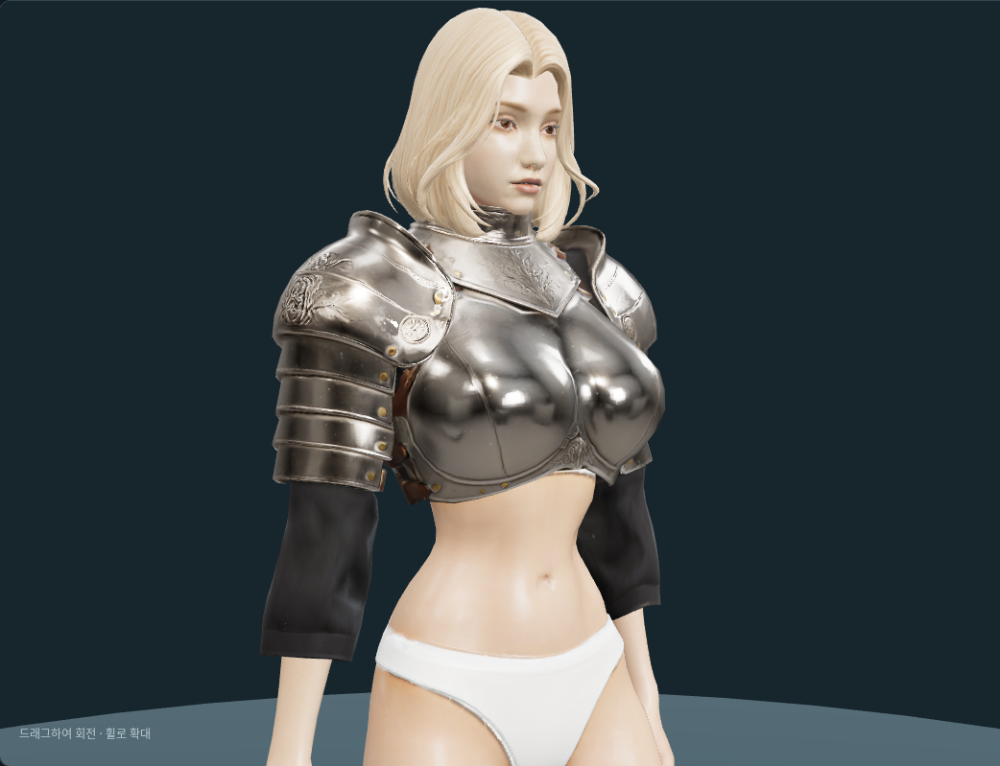

# 여성 기사 상의 — 2026-10-12

사용자가 제공한 은색 갑옷 사진을 참고해 만든 모듈형 여성 기사 상의다.
현재 사용본은 **v3**이며 여성 캐릭터 제작용 미리보기에 연결했다.
게임 장비 등록과 다른 장갑·투구 조합은 후속 검증 범위다.



## 출처와 생성

- 원화: OpenAI Codex built-in ImageGen, **ChatGPT Pro 20x**, 2026-10-12.
  사용자 참고 사진의 원저작자·라이선스는 미확인이다. 생성 원화에는 OpenAI 출력물 이용 조건이 적용된다.
- [앞뒤 원화](../../assets/items/female_knight_top/concept_v1/sheet.png),
  [앞면](../../assets/items/female_knight_top/concept_v1/front.png),
  [뒷면](../../assets/items/female_knight_top/concept_v1/back.png),
  [프롬프트](../../assets/items/female_knight_top/concept_v1/prompt.txt),
  [출처·해시](../../assets/items/female_knight_top/concept_v1/sources.json).
- Tripo API 유료 크레딧, 모델 `P2-20260801`, 텍스처 `v3.5-20260815`, detailed PBR,
  입력 조명 제거, 삼각형 목표 4,000. [API 문서](https://developers.tripo3d.ai/en/docs/generation-multiview-to-model/p),
  [이용 조건](https://developers.tripo3d.ai/en/terms).
- 원화의 `[0,128,768,704]`, `[768,128,768,704]` 영역을 FFmpeg로 추출해
  앞·뒤 두 시점으로 제출했다. 글자와 바깥 여백만 제외하고 형상은 변경하지 않았다.
- 작업 ID `93a31e72-6ad5-4e28-84c6-293ddf9062cc`, **120크레딧 사용**.
  완료 후 잔액 400크레딧·보류 0크레딧을 확인했다. 로컬 피팅에는 추가 API 비용이 없다.
- [제작 명세](../../assets/items/female_knight_top/tripo_v1/build.json),
  [요청·비용·작업 기록](../../assets/items/female_knight_top/tripo_v1/generation.json).
  재제출하지 않고 `tools/outfits/tripo.py`로 기존 작업을 조회·회수한다.

## 원본과 현재 파일

| 용도 | 파일 |
| --- | --- |
| Tripo 원본 | [model_url.glb](../../assets/items/female_knight_top/tripo_v1/source/model_url.glb) |
| 원본 Blender | [source.blend](../../assets/items/female_knight_top/tripo_v1/source.blend) |
| 현재 상의 | [v3/top_female_knight.glb](../../assets/items/female_knight_top/tripo_v1/fitted_v3/top_female_knight.glb) |
| 착용본·기존 9동작 | [v3/female-knight-assembled.glb](../../assets/items/female_knight_top/tripo_v1/fitted_v3/female-knight-assembled.glb) |
| 현재 Blender 편집본 | [v3/female-knight-top-fitted.blend](../../assets/items/female_knight_top/tripo_v1/fitted_v3/female-knight-top-fitted.blend) |
| 착탈 가림 명세 | [v3/body-occlusion.json](../../assets/items/female_knight_top/tripo_v1/fitted_v3/body-occlusion.json) |
| 재생성 기준 | [v2/top_female_knight.glb](../../assets/items/female_knight_top/tripo_v1/fitted_v2/top_female_knight.glb), `v2/fit-data.npz`, `v2/body-occlusion.json` |
| 보정·검수 대응 데이터 | `v3/sleeve-adjustment.npz`, `v3/sleeve-adjustment.json` |

Blender 편집본에는 기준 여성 리그, 착용 몸체·상의, 가리지 않은 비교 몸체와 9개 액션이 있다.
원본은 메시 1개, **4,279 triangles**, 4K 컬러·노멀·ORM 텍스처다.
UV 이음만 임시 용접한 원본 진단은 연결 성분 9개, 경계선 123개, 퇴화 면·UV 붕괴 0개였다.
[원본 진단](../../assets/items/female_knight_top/tripo_v1/review.json)과
[재현 스크립트](../../assets/items/female_knight_top/tripo_v1/review_source.py)를 보관한다.

## 피팅과 소매 보정

기준 몸체는 `assets/modular_human_female_01/rig_v1/female-base.glb`,
리그는 `human_female_01_local_v1`의 65본이다. 기준 체형·가슴 크기·동작은 변경하지 않았다.
짧은 흉갑·등판, 목 보호대, 견갑·상완 판금, 검은 천 소매와 가죽 고정끈이 상의에 속한다.
복부는 의도적으로 노출한다. 소매는 팔꿈치를 덮고 팔뚝에서 끝난다.

v2에서 Tripo 원본을 배율 0.32, Z −90°, 이동 `(0, 0.004, 0.768)`의 Blender 좌표로 정렬했다.
가슴 영역의 폭을 최대 10%, 앞쪽 깊이를 최대 18% 확대하고 실제 몸체 표면을 광선으로
샘플링해 제작 좌표 `0.008`의 여유를 확보했다. 여성 몸체 높이는 1의 제작 좌표이며
이 값을 확정된 실제 미터 치수로 취급하지 않는다.
몸통·견갑을 고정한 ARAP 변형으로 소매를 A 자세의 팔에 맞췄다.
흉갑 중심은 `Spine1 0.9 + Spine2 0.1`, 견갑 중심은 같은 쪽 `Shoulder`를 따른다.
갑옷 중심의 웨이트를 고정하고 경계에서 보간한다.

v3는 팔보다 좁고 중심이 어긋난 소매 입구를 실제 팔 표면에 맞춰 넓혔다.
안감과 바깥 천 사이 두께를 남기고, 끝단을 팔꿈치 접힘 중심 아래로 이동했다.
실제 피부 삼각형의 스킨 웨이트를 보간해 팔·팔뚝 본을 따라 움직이도록 했다.
흉갑·견갑 형상, UV·텍스처 바이트, 4,279삼각형, 기준 본 계층과 bind 정보는 유지한다.

## 미리보기와 가림

개발 서버의 `/modular-character-preview.html?character=female&camera=upper&top=knight`에서 연다.
`상의`에서 착탈하고, 동작·시점·헤어·무기·와이어프레임을 함께 바꿀 수 있다.
상의를 선택할 때 불러오고 같은 화면에서 재사용한다.

경량 여성 베이스의 mesh 0 / primitive 0에 원본과 같은 삼각형 순서가 유지되는 것을 확인했다.
상의와 가림 정보가 모두 준비된 뒤 기본 상의·뒤쪽 리본 2,488면과 덮이는 피부 2,384면을 숨긴다.
복부·얼굴·손과 노출된 팔뚝은 유지한다. 기준 몸체 파일 자체에는 삭제를 적용하지 않는다.
벗기기·로딩 실패·화면 종료 시 원래 몸체를 복원하며, 로딩 중 변경한 선택도 유지한다.
v3 가림 명세는 v2와 동일하다.

| 조립 범위 | 숨김 포함 | 표시 |
| --- | ---: | ---: |
| 몸체 + 상의 | 26,454 | 21,582 |
| 몸체 + 상의 + 금발 단발 | 28,890 | 24,018 |

얼굴은 기존 4,604삼각형을 유지한다. 무기·의자·망토는 위 합계에 포함하지 않았다.
기준 몸체 자체가 22,175삼각형이어서 조립 목표 15,000–20,000을 넘으며, 수치 맞춤 감축은 하지 않았다.

## 검증과 한계

- `bindModularPart`로 기준 여성 본에 연결해 9동작 × 121시점에서 본·inverse bind 일치,
  기본 자세 유지, 웨이트 정규화, 반대쪽 팔 영향 없음, 유한 변형과 흉갑 강성을 확인했다.
  흉갑 중심 모서리 길이 변화는 최대 약 0.79%다.
- 소매 입구 경계 정점 20개를 같은 쪽 팔 표면과 비교한 9동작 × 17시점에서
  피부 안으로 들어가는 입구 정점은 0개였다. 갑옷 전체의 충돌이 0이라는 의미는 아니다.
  가림 전 피부·다른 신체 부위와 의상 안쪽의 접촉은 남는다.
- Headless Chromium/SwiftShader에서 A 포즈·8개 동작, 착탈·헤어 제거,
  지연 응답 중 선택 변경, 로딩 실패 후 복원·재시도를 확인했다. 타입 검사·린트 통과.
- 상의 glTF 오류·경고 0개. 착용본은 오류 0개·기준 몸체의 tangent-space 경고 1개다.
- 다른 장갑·투구와 혼합, 긴 장갑과의 겹침 깊이, 출시용 장비 등록은 미검증이다.
  높은 목 보호대와 투구에는 별도 옷깃 대체 형상이 필요할 수 있다.

[최종 피팅·입구 검사 요약](modular-female-knight-top-fitting-v3.json),
[본 결합·동작 검사](modular-female-knight-top-animation-v3.json),
[브라우저 검사](modular-female-knight-top-preview-v3.json),
[가슴 피팅 기록](modular-female-knight-top-fitting-v2.json).
원본·최종 파일 해시는 `v3/local-artifacts.json`과 `assets.lock`에 기록한다.

## 실패 이력과 정리

- **[미사용] v1**: 사용자 검수에서 소매 찌그러짐과 견갑·흉갑 변형이 부적절했다.
  원본 GLB에서 피팅·웨이트를 다시 제작했다.
- **[미사용] v2 착용 후보**: 가슴 크기와 판금 변형을 개선했지만 소매 입구가 팔을 뚫었다.
  v2 상의·대응 데이터는 v3 재생성 입력으로만 보관한다.
- 소매/견갑의 급격한 공간 회전은 판금 접힘을, 파츠 임의 분리는 연결부 틈을 만들었다.
  연결된 원본 표면의 ARAP 변형으로 바꿨다.
- 피팅 전 좌표로 소매 웨이트를 분류하면 몸통 웨이트가 남아 긴 삼각형이 생겼다.
  피팅 후 위치 분류와 고정 중심·경계 보간으로 수정했다.
- 넓은 천 영역의 v3 첫 보정은 주름·음영을 손상시켰다. 범위를 아래 소매로 좁히고
  원본 커스텀 노멀을 회전으로 옮겼다. 폭만 고친 후보는 깊게 굽힌 달리기에서 입구가
  팔꿈치에 걸려, 최종본에서는 끝단을 접힘 중심 아래로 옮겼다.
- 2026-10-12 사용자 요청에 따라 실패 모델, 이전 편집본·착용본, 반복 검수 이미지와
  임시 진단 파일을 정리했다. 원화·Tripo 원본·현재 편집본·필수 재생성 입력과 실패 기록은 유지한다.

## 재현

v2 입력이 이미 보관돼 있으므로 v3만 재생성할 때는 다음을 실행한다.
검수 렌더·중간 데이터는 실행 시 다시 생성된다.

```bash
blender -b -t 6 --python-exit-code 1 --python tools/blender-scripts/adjust_female_knight_sleeves.py
.venv/bin/python tools/outfits/export_female_knight_sleeves.py
node tools/validate-female-knight-top-v2.mjs v3
blender -b -t 6 --python-exit-code 1 --python tools/blender-scripts/review_female_knight_top_v2.py -- v3
.venv/bin/python tools/outfits/assemble_female_knight_top.py v3
```

Tripo 원본에서 v2 기준을 다시 만들려면 먼저 다음을 실행한다.

```bash
blender -b -t 6 --python-exit-code 1 --python tools/blender-scripts/fit_female_knight_top_v2.py
.venv/bin/python tools/rig-female-knight-top-v2.py
.venv/bin/python tools/outfits/female_knight_top_occlusion.py
```
