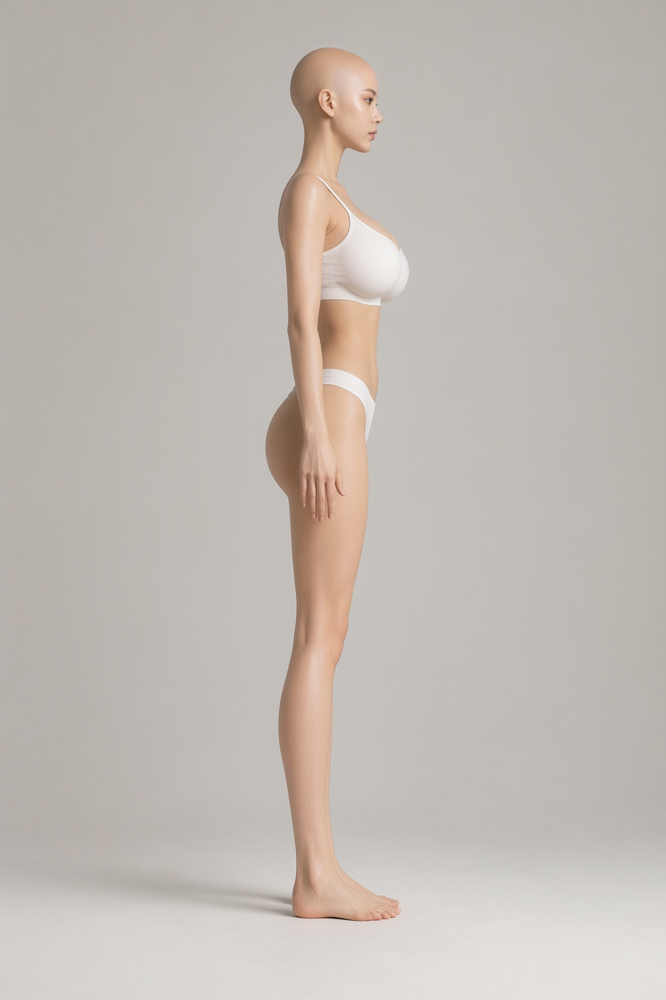

# 여성 모듈형 공통 몸체

## 실제 의자 기준 앉기 보정 — 2026-10-12

앉기에서 손이 무릎에 묻히고 허벅지가 과하게 솟던 자세를 게임의 `Chair`로 맞췄다.
미리보기의 앉기 선택 시 `objects/chair.glb`를 함께 표시하고, 게임 카탈로그의
상호작용 높이 보정 **0.08**도 적용한다. 여성 모델은 높이 1의 제작 좌표를 유지한다.
기존 무기 미리보기와 같은 **키 1.8 기준**으로 의자 크기를 환산했으며, 여성 캐릭터의
최종 게임 키를 확정하거나 게임 캐릭터 선택에 연결한 변경은 아니다.

엉덩이 아래 표면을 좌석에 맞추고 발바닥을 바닥에 고정한 뒤 무릎·발목 각도를 다시 풀었다.
기존에는 무릎이 골반보다 높았지만 보정 후 자연스럽게 아래로 내려온다.
상체는 8도 앞으로 기울이고 손을 실제 변형된 무릎 쪽 허벅지 표면 위에 맞췄다.
추가 피드백에 따라 팔꿈치를 몸 옆으로 모으고, 목·머리 회전을 나눠 보정해 정면을 바라보게 했다.
양쪽 쇄골도 아래로 29도 내려 움츠린 어깨를 완화하고, 팔 관절을 다시 풀어 손의 무릎 접촉을 유지했다.
좌석에 체중이 실려 살이 눌리는 느낌을 위해 엉덩이 아래 표면을 게임 크기 기준
**0.03(약 3cm)** 좌석 안으로 내렸다. 첫 1cm 보정에서 약 2cm 더 내린 설정이다.
이는 골반 높이 보정이며 별도의 연부조직 변형은 아니다.
발바닥 고정과 손의 무릎 접촉은 다시 계산해 유지했다.
허벅지에 팔·손 본의 잘못된 영향은 발견하지 못했다. 가중치나 형상을 변경하지 않고
과한 허벅지 굽힘을 완화했으며, 다른 8개 동작은 트랙 값까지 동일하다.

- 현재 모델·편집용 원본: `rig_v1/female-base.glb`, `rig_v1/female-base.blend`.
- 61시점에서 양손의 무릎 표면 접촉, 의도한 좌석 눌림, 정면 시선과 팔꿈치 위치를 검사한다.
  수치는 높이 1의 제작 좌표 기준이다. 기존 리그 검사도 9동작 × 121시점 통과했다.
- 실제 브라우저의 정면·측면·후면, 각 4시점에서 확인했다. 페이지 오류 없음.
- 기존 Mixamo 동작·게임 의자·여성 Tripo/이미지 편집 출처와 이용 조건을 따른다.
  신규 생성·유료 API 호출은 없다.
- [출처·파일 해시·접촉 검사](modular-human-female-01-seated-v1.json).

```sh
node tools/tune-female-seated.mjs
.venv/bin/python tools/rig-female-base.py --animations
node tools/validate-female-rig.mjs
node tools/validate-female-seated.mjs
blender -b -t 4 --python tools/blender-scripts/save_female_rig.py
```

전체 재생성용 `animate-female-base.mjs`에도 같은 앉기 보정을 적용했다.
아래 캣워크 기록의 출력 해시는 앉기 보정 전 이력이며, 현재 출력은 위 기록을 따른다.
커밋 정리 후 `rig_v1/`에는 최종 GLB·Blender와 제작 입력 `catwalk-source.glb`를 보관한다.
중간 클립 JSON·포즈 스냅샷·접지 샘플 등 5개 파일은 제거했고 검증 결과는 위 기록에 보존했다.

## 여성 전용 캣워크 — 2026-10-12

현재 여성 리깅본의 `walk`를 패션 모델 스타일의 캣워크로 교체했다.
기존 `assets/all_animation.blend`의 Mixamo `walk_cat` 액션을 여성 골격으로 리타게팅하고,
골반 기준 발목의 좌우 이동 폭을 28%로 좁혔다. 발의 월드 회전은 유지해 발바닥이 안쪽으로 기울지 않게 했다.
골반·어깨·팔의 원본 캣워크 움직임과 기존 편안한 손가락 자세를 사용하며,
제자리 반복 연결과 60 Hz 발바닥 접지를 보정했다. 이전 걷기에 적용했던 남성 원본 기준 시선 보정은
새 캣워크의 목·머리 동작으로 대체했다.

사용자 피드백에 따라 양쪽 쇄골을 아래로 6도 돌려 올라간 어깨를 완화했다.
상완의 월드 회전을 보상해 팔 스윙을 유지했다. 121시점에서 어깨 관절이 모델 높이의
약 0.52–0.56% 내려갔고, 보간에 따른 상완 회전 차이는 최대 0.17도였다.

- 미리보기: `/modular-character-preview.html?character=female&camera=full&motion=walk`.
- 결과: `rig_v1/female-base.glb`와 텍스처·9개 액션을 내장한 `female-base.blend`.
- 다른 8개 동작의 시간·트랙 값은 직전 여성 모델과 동일하다. 형상·재질·텍스처도 유지했다.
- 정면·측면·후면의 네 시점을 브라우저에서 확인했으며 페이지 오류는 없었다.
  9개 동작 각각 121시점의 기존 리그 검사와 캣워크의 반복 연결·중앙선 근처 발 디딤 검사를 통과했다.
- 출처·이용 조건: 기존 프로젝트 Mixamo 애니메이션과 여성 Tripo/이미지 편집 기록을 따른다.
  로컬 편집만 수행했으며 신규 생성·유료 API·추가 구독 사용은 없다.
- [출처 해시와 검사 결과](modular-human-female-01-catwalk-v1.json).

기존 여성 리깅본에서 걷기만 다시 적용하는 명령:

```sh
blender -b -t 4 --python tools/blender-scripts/export_female_catwalk.py
node tools/tune-female-catwalk.mjs
.venv/bin/python tools/rig-female-base.py --animations
node tools/validate-female-rig.mjs
blender -b -t 4 --python tools/blender-scripts/save_female_rig.py
```

리깅부터 전체 재생성할 때에도 먼저 캣워크 원본을 추출한다.
아래 `animate-female-base.mjs`가 같은 캣워크 보정을 포함한다.

## 로컬 리깅과 동작 미리보기 — 2026-10-12

현재 미리보기는 `assets/modular_human_female_01/rig_v1/female-base.glb`다.
같은 폴더의 `female-base.blend`에 65본과 8개 편집 가능한 액션, 사용 텍스처를 내장했다.
Blender 파일은 기본 A 포즈로 열리며, 액션을 선택하거나 해당 NLA 트랙의 음소거를 해제해 재생한다.
리깅 전 `ear_normals_v2/base-ear-normals-v2.glb`와 `.blend`는 보존한다.

남성 모듈러 몸체에서는 본 이름·계층·회전축과 기존 동작만 참조했다.
여성 몸체의 관절 위치·본 길이·기준 회전·inverse bind를 새로 만들고 Blender bone-heat로 가중치를 계산했다.
남성 의상·몸체 형상·재질을 가져오지 않았다. 별도 Mixamo 업로드나 유료 생성 호출도 없다.

원본 GLB는 하나의 메시 안에 몸체와 흰색 기본 상·하의의 연결되지 않은 표면을 포함한다.
이는 새로 만든 여성 장비가 아니다. 자동 가중치만 사용한 첫 후보에서는 상의와 피부가 다르게 변형되어
피부가 상의를 뚫고 나왔다. 같은 메시 안의 기본 의상 표면에 아래 몸체의 표면 보간 가중치를 적용해 보정했다.
얼굴 상부와 별도 속눈썹 형상은 Head 본에 고정했다. 표정·눈 깜빡임 리그는 포함하지 않는다.

대기·걷기·달리기·점프·전투 대기·베기·쓰러지기·앉기의 8동작을 GLB에 내장했다.
여성 체형의 이동량을 맞추고 60 Hz로 접지 보정을 구웠으며, 달리기·점프의 공중 구간은 유지했다.
서로 다른 기준 골격을 구분하기 위해 `human_female_01_local_v1` 리그 ID를 사용한다.
남성 전용 파츠나 전용 동작 팩을 그대로 연결하는 구조는 아니다.

- 미리보기: `/modular-character-preview.html?character=female`. 기본 A 포즈, 동작 선택, 일시정지·재생,
  시점 슬라이더, 뼈대·와이어프레임과 얼굴·전신·측면·후면·발 카메라를 제공한다.
- 형상: **22,175삼각형**, 원본 정점·인덱스·노멀·UV·재질·내장 이미지 보존.
  기본 속옷과 안쪽 몸체를 포함한 총합이며, 렌더에서 활성화되는 총합도 같다. 이번에 폴리곤을 추가하지 않았다.
  얼굴 앞면 기준 영역은 속눈썹 포함 **4,604삼각형**이다. 영역 판정 좌표는 검사 기록에 명시했다.
- 검증: 8동작 × 121시점, 유한 좌표·가중치 합·기준 형상 유지·얼굴 강체 변형·접지 검사 통과.
  높이 1 기준 최대 바닥 관통은 약 0.000377이다. GLB 검증 오류 0, 원본과 같은 tangent-space 경고 1개.
- 브라우저: 8동작과 기본 자세, 정면·측면·후면·얼굴, 일시정지·재생·스크럽·뼈대 표시를 확인했다.
  클라이언트 `npm run check`와 `npm run lint` 통과.
- 범위: 제작용 리깅과 미리보기. 게임 캐릭터 선택·여성 장비 슬롯·무기 그립·표정에는 아직 연결하지 않았다.
  원본 높이 1의 제작 좌표를 유지하며 게임에서 사용할 실제 키는 별도 결정한다.

출처와 이용 조건은 기존 Tripo API 생성물, 사용자 입력 원화, ImageGen 보정 및 Mixamo 동작 기록을 따른다.
이번 단계는 로컬 계산이며 신규 AI 생성·구독 사용·과금은 없다.
[입출력 해시와 검사 기록](modular-human-female-01-rig-v1.json).

2026-10-12 사용자 요청으로 리깅 검토 이미지와 중간 애니메이션 JSON 등 24파일을 정리했다.
`rig_v1/`에는 최종 GLB와 편집용 Blender 파일만 남겼다. 출처·검증 결과·삭제 목록은 위 기록에 통합했다.
리깅 전 입력과 제작 스크립트는 보존한다. 아래 명령을 순서대로 실행하면 중간 JSON을 다시 생성한다.

```sh
.venv/bin/python tools/rig-female-base.py
node tools/animate-female-base.mjs
.venv/bin/python tools/rig-female-base.py --animations
node tools/validate-female-rig.mjs
blender -b -t 4 --python tools/blender-scripts/save_female_rig.py
```

## 현재 보관본과 중간 생성물 정리 — 2026-10-11

이 정리 단계의 미리보기는 `assets/modular_human_female_01/eye_normals_v1/base-eye-normals-v1.glb`와 같은 폴더의 `.blend`였다. 속눈썹 뿌리 두께·콧구멍 음영과 오른쪽 눈 노멀 보정을 포함한다. 재현 입력인 eyelashes v10 GLB 하나만 보존하고, 나머지 중간 모델과 검토 이미지는 삭제했다. **22,175삼각형**이며 눈 텍스처와 속눈썹 뿌리 보정을 포함한다. 현재 후속 편집 기준은 위 리깅본이다.

사용자 요청으로 이전 단계의 파생 GLB·Blender 파일, 중복 텍스처와 비교 렌더를 삭제했다. 원본 생성 모델, 입력 원화, 눈 편집 입력 이미지와 작은 제작·검증 기록은 남겼다. 아래 과거 단계에 적힌 경로와 해시는 당시 작업 이력이며 현재 파일의 존재를 뜻하지 않는다. 단계별 보정 스크립트는 제작 이력으로 보존하며, 삭제한 입력 모델을 먼저 재구성해야 실행할 수 있다. 전체 과정을 한 번에 재현하는 빌드는 제공하지 않는다.

[삭제 목록과 해시](modular-human-female-01-cleanup.json) · [최종 출처·검증 기록](modular-human-female-01-eye-normals-v1-sources.json)

2026-10-11. 현재 여성 모듈형 캐릭터의 기준은 사용자가 ComfyUI / Qwen Image 2.1로
제공한 정면 `Qwen_image_2.1_00012.png`와 측면 `Qwen_image_2.1_00025.png`다.
두 이미지의 Tripo API 재생성은 콘텐츠 정책 오류로 거절됐지만,
이후 사용자 요청으로 정면만 사용한 20,000삼각형 목표의 v3 모델 생성에 성공했다.
기존 여성 기사와 로그를 참고한 v1, 흰색 기본 속옷으로 수정한 v2의 제작 이력은 보존한다.




- 정면 전신 A 포즈, 맨손·맨발, 아래·몸 쪽을 향하는 손바닥.
- 흰색 가는 어깨끈 상의와 비키니형 하의로 상체·허리·허벅지 윤곽을 표현했다.
- 머리카락 없는 두피를 기준으로 하며 헤어는 별도 파츠로 제작한다.
- 정면·측면 원화에서 발바닥 접지를 확인할 수 있다. 실제 생성 메시의 접지는 별도 확인이 필요하다.
- 측면은 캐릭터의 왼쪽을 보여주며 팔은 정면 A 포즈보다 내려가 있다.

기존 Tripo 메시는 v2 기반이며 이후 v3 기반 Meshy와 Tripo P2 API 후보도 생성했다.
각 원본의 정면·측면과 확대를 비교했으며 기준 몸체 보정·리깅·의상 호환 검증은 아직 진행하지 않았다.
여성 체형의 연결부는 실제 3D 몸체에서 정하며 남성 전용 치수를 그대로 적용하지 않는다.

## 기본 속옷 수정 방향 — 2026-10-11

사용자는 남성 바바리안 하의 제작 때 기본 속옷이 드러나 수정했던 경험을 바탕으로,
짧거나 옆이 열린 복장에 대응하기 쉬운 비키니 형태의 기본 속옷을 제안했다.
상의와 반바지를 단순한 비키니 형태로 교체하는 ImageGen 편집을 요청했으나
도구의 안전 필터가 입력을 차단했다. 이후 사용자가 직접 편집한 이미지를 제공하고
기준 원화로 지정해 v2로 보관했다. 이전 요청 프롬프트와 실패 ID는 출처 기록에 유지한다.

**[미사용]** `base-front-v1.png`: 회색 상의·반바지 초안. 제작 이력으로 보존하며 v2로 대체했다.

**[미사용]** `base-front-v2.png`: 묶은 머리·흰색 기본 속옷 원화. 기존 Tripo 메시의 입력 이력으로 보존하며 정면 기준은 v3로 대체했다.

**[미사용]** `base-front-v3.png`: 이전 대머리 정면 원화. Meshy·Tripo API v1 입력 이력으로 보존하며 현재 기준은 `Qwen_image_2.1_00012.png`로 대체했다.

3D 제작 시 몸체·속옷을 별도 메시로 구성하고 속옷을 피부 텍스처에 굽지 않는 방향을 권장한다.
기본 속옷은 장비가 없을 때 표시하고, 장비별 가림 범위에 따라 숨기거나 대체한다.
치마 아래처럼 보일 수 있는 영역에는 해당 의상에 맞는 안감을 유지한다.
가림은 장비 표시 성공 시 적용하고 해제·로딩 실패 시 복원한다.
베이스의 맨발 중립 자세는 유지한다. 이는 제작 방향이며 아직 3D에 구현하지 않았다.

## Tripo 생성 메시 검토 — 2026-10-11

- 사용자 제공: `/mnt/y/web_downloads/fitness+model+3d+model.glb`.
- 보관 원본: `assets/modular_human_female_01/tripo_base_v1/source.glb`. 원본과 바이트 일치를 확인했다.
- 실측 **11,493 triangles**, 메시 오브젝트 1개, 재질 1개, 리그·애니메이션 없음.
- 논의한 목표는 6,000쿼드였으나 실제 제출 설정과 원래 쿼드 수는 미확인이다.
- 헤어는 별도 오브젝트로 제공되지 않았다. 분리된 연결 성분은 있어 전부 용접된 단일 표면으로 단정하지 않는다.
- 교체형 헤어를 위해 머리카락을 분리하고, 그 아래 온전한 두피가 있는지 확인해 필요하면 복원한다.
- 측면에서 뒤꿈치가 뚜렷하게 들려 있다. 리깅 전에 뒤꿈치·앞꿈치 접지를 교정하고 자연스러운 아치를 유지한다.
- 원본 생성은 Tripo, 사용 등급·정확한 생성일·이용 조건은 제공되지 않아 미확인이다.
- 검토 렌더는 Blender로 생성했으며 원본 모델의 이용 조건을 따른다.
- [원본 해시·기하 진단·검토 이미지 경로](modular-human-female-01-tripo-sources.json).

## Meshy 생성 메시 비교 — 2026-10-11

- 사용자 제공: `/mnt/y/web_downloads/Meshy_AI_Bald_Female_Figure_1011075003_texture.glb`.
- 보관 원본: `assets/modular_human_female_01/meshy_base_v1/source.glb`. 첨부 경로 원본과 바이트 일치를 확인했다.
- 실측 **12,282 triangles**, 메시·재질 각 1개, 리그·애니메이션 없음. 기존 Tripo보다 약 6.9% 많다.
- Meshy는 base-color·metallic/roughness·normal 각 2048², Tripo는 base-color 2048² 한 장이다.
- 동일 조명·카메라에서 전체 높이를 1로 정규화해 비교했다. Tripo 높이는 헤어를 포함한다. 중립 재질로 텍스처·노멀맵을 제거한 얼굴도 확인했다.
- 이번 결과에서는 Tripo의 눈꺼풀·입술 형상이 더 명확하다. Meshy는 두피·어깨 윤곽이 각지고 얼굴 형상이 덜 정돈되어 있다.
- Meshy의 엄지·손끝은 뾰족하게 찌그러진 부분이 있다. Tripo의 손은 상대적으로 매끄럽지만 손가락 분리 확인은 여전히 필요하다.
- Meshy의 발은 이전 Tripo보다 평평한 자세에 가깝다. 발가락 변형과 정확한 접지는 보정이 필요하다.
- 두 생성기의 입력 원화와 설정이 달라 이번 결과만으로 서비스 전체의 품질 우열을 판단하지 않는다.
- Meshy 원본은 보정 후보로 보관하며 확정 몸체·리깅 입력으로 채택하지 않았다.
- 출처: Meshy AI 사용자 생성물. 정확한 생성일·등급·이용 조건·생성 설정은 미확인이다. 검토 렌더는 Blender이며 원본 이용 조건을 따른다.
- [해시·기하 진단·비교 조건·이미지 경로](modular-human-female-01-meshy-sources.json).

## Tripo P2 API 생성 — 2026-10-11

- 사용자 결제 API 크레딧으로 **1건 생성**, **120크레딧 사용**, **880크레딧 잔액**을 API로 확인했다.
- 입력은 v3 정면 한 장이다. `P2-20260801`, 6,000쿼드 목표, PBR·detailed 텍스처, `v3.5-20260815`, 이미지 자동 수정 끄기, 고정 시드를 사용했다.
- 실제 FBX는 **5,352쿼드＋1,504삼각형**, 환산 **12,208삼각형**이다. 순수 6,000쿼드 결과가 아니다.
- 4종의 4096² 텍스처가 포함됐다. GLB에는 base-color·normal·metallic/roughness 결합 맵을 보존했다.
- 대머리 두피와 평평한 발 자세가 반영됐고, 손 확대에서 다섯 손가락 분리를 확인했다.
- Meshy 후보보다 얼굴 형상과 엄지가 매끄럽다. 눈꼬리·입 주변 텍스처와 겨드랑이·의상 가장자리는 보정이 필요하다.
- 원본 FBX: `assets/modular_human_female_01/tripo_api_v1/model_url.fbx`.
- 원본 편집용: 같은 폴더의 `source.blend`, 원본 축 변환본 `source.glb`.
- 확인용: `base-review.glb`. 정면을 맞추고 높이를 1로 정규화했으며 실제 캐릭터 키나 리그를 확정한 파일은 아니다.
- 비교 렌더: 같은 폴더 `comparison/`의 정면·측면·후면·얼굴·손·발. 원본 형상은 수정하지 않았다.
- 출처: 유료 Tripo API, 2026-10-11. [Tripo 이용 조건](https://developers.tripo3d.ai/en/terms) 적용. 입력 원화 출처는 기존 기록을 따른다.
- [생성 설정](modular-human-female-01-tripo-api-v1-build.json), [작업 ID·비용·다운로드 해시](modular-human-female-01-tripo-api-v1-sources.json), [검토·파생 파일 기록](modular-human-female-01-tripo-api-v1-review.json).

생성 성공과 리깅·모듈형 복장 호환 승인은 별개다. 이 결과는 보정 후보이며 자동 추가 생성은 하지 않았다.
`tools/outfits/tripo.py`는 제출 전에 상태를 저장하고 기존 기록이 있으면 중복 제출을 거부한다.
입력 변경·응답 유실·작업 ID 저장에 대한 3개 테스트를 통과했다.

## Tripo P2 API 다중 시점 재생성 시도 — 2026-10-11

- 사용자 요청으로 이전 12,208삼각형보다 얼굴 형상을 세밀하게 만들기 위해 **15,000쿼드 목표(약 30,000삼각형)**로 높였다. 기존 모듈형 캐릭터 예산보다 높은 제작 후보 설정이다.
- 입력: `Qwen_image_2.1_00012.png` 정면과 `Qwen_image_2.1_00025.png` 왼쪽 측면. `../image-kiln/vendor/ComfyUI/output/` 원본을 변환 없이 복사했으며 첨부본과 SHA-256이 일치한다.
- `P2-20260801`, `quad=true`, PBR·detailed 텍스처, `v3.5-20260815`를 설정하고 `/v3/generation/multiview-to-model`로 1회 제출했다.
- 응답: **HTTP 400, 코드 2008**, `The input is rejected due to violation of content policy`. 서비스가 어떤 이미지나 요소를 문제로 판단했는지는 알려주지 않았다.
- 작업 ID·생성 모델 없음. 재제출하지 않았다. 전후 잔액 **880크레딧**, 보류 **0크레딧**, 확인된 잔액 감소 **0크레딧**이다.
- 기존 모델과 여성 베이스 미리보기는 유지한다. 입력별 해시 검증·다중 시점 요청 기록·응답 유실 시 중복 제출 차단을 포함해 제출 도구의 5개 테스트를 통과했다.
- 도구·등급: 유료 Tripo API 크레딧. 시도일 2026-10-11. [공식 다중 시점 API 문서](https://developers.tripo3d.ai/en/docs/generation-multiview-to-model/p), [Tripo 이용 조건](https://developers.tripo3d.ai/en/terms).
- [제출 설정·원화 출처](modular-human-female-01-tripo-api-v2-build.json), [거절 응답·요청 ID·잔액 기록](modular-human-female-01-tripo-api-v2-sources.json).

## 눈 텍스처 보정 — 2026-10-11

사용자 요청으로 Tripo P2 API v1의 눈 주변 색상·노멀맵을 국소 보정했다.
UV가 여러 조각으로 나뉘어 있어 정면 무조명 색상 투영을 ImageGen으로 편집하고,
깃털 경계의 눈 마스크를 사용해 원래 4096² UV 텍스처에 다시 구웠다.
눈동자·눈꺼풀 경계의 번짐을 정리하고 눈가 노멀맵의 과한 굴곡을 마스크 중심에서 85% 낮췄다.

- 수정 모델: `assets/modular_human_female_01/eyes_v1/base-eyes-v1.glb`.
- 편집본: 같은 폴더의 `base-eyes-v1.blend`.
- 검토: `head-front.png`, `head.png`, `head-other.png`에서 정면과 양쪽 사선을 확인했다.
- 최종 GLB는 원본의 색상·노멀 이미지 데이터만 교체했다. **12,208삼각형**, 정점·노멀·UV·재질 설정과 나머지 버퍼는 동일하다.
- 눈 마스크 밖은 색상·노멀맵 모두 픽셀 차이 **0**을 확인했다. 입·의상은 이번 수정 대상이 아니다.
- ImageGen **ChatGPT Pro 20x**, 2026-10-11. OpenAI 생성 출력물 이용 조건과 기존 모델·참고 이미지 출처 조건을 따른다.
- 추가 Tripo API 요청·크레딧 사용 없음. 원본 모델은 보존했다.
- [전체 편집 프롬프트·출처·검증 기록](modular-human-female-01-eyes-v1-sources.json).

눈 보정본은 원본 경로에 보존한다. 개발 서버의 여성 베이스 미리보기는 아래 정면 원화 v3 생성본으로 갱신했다.

## Tripo P2 API 정면 단독 재생성 v3 — 2026-10-11

- 사용자 요청: `Qwen_image_2.1_00012.png` 정면 한 장, **20,000삼각형 목표**. `quad=false`, `face_limit=20000`, `P2-20260801`, PBR·detailed·`v3.5-20260815`를 사용했다.
- 생성 성공. 실제 **20,927삼각형**, 메시 1개, 리그 없음. 목표보다 4.635% 많으며 개수만 맞추기 위한 추가 감축은 하지 않았다. 이전 API v1은 12,208삼각형이었다.
- base-color·normal·ORM 텍스처 각 **4096²**를 포함한다. 원본·축 변환본·확인용 GLB 모두 20,927삼각형과 내장 이미지 3개를 확인했다.
- **120크레딧 사용**, 잔액 **760크레딧**, 보류 **0크레딧**. 이번 요청은 1회 제출했다.
- 정면 단독 요청 성공만으로 앞선 다중 시점 거절의 원인을 측면 이미지라고 확정할 수는 없다.
- 원본: `assets/modular_human_female_01/tripo_api_v3/model_url.glb`. 같은 폴더에 `source.blend`, `source.glb`, `base-review.glb`와 `comparison/` 검토 렌더를 보관했다.
- 확인용 모델은 정면을 맞추고 높이를 1로 정규화했다. 형상 보정·리깅·모듈형 복장 호환 검증은 아직 하지 않았다.
- 사용자가 눈 주변의 돌출 평면을 속눈썹으로 확인했다. 원본 GLB 검사 결과 base-color가 알파 없는 RGB JPEG이고 재질은 `alphaMode`가 생략된 불투명 상태이며 양면 렌더링한다. 속눈썹용 투명 마스크가 없어 평면이 그대로 보인다. 앞선 눈꺼풀 형상 결함 판단을 정정하며, 속눈썹 형상을 보존하고 해당 UV 영역의 알파 마스크를 마련해야 한다. 재질 투명도 설정만으로는 누락된 마스크가 복원되지 않는다. 이 진단을 바탕으로 아래 속눈썹 보정본을 제작했다.
- 측면에서 뒤꿈치가 앞꿈치보다 들려 있다. 손끝도 일부 불규칙하다. 리깅 전에 접지·손가락·속눈썹 투명도를 검토해야 한다.
- 기하 진단: 퇴화 면 2개, 축소된 UV 삼각형 2개, 경계·비매니폴드 에지 검출. 원본을 유지하고 결과를 기록했다.
- 개발 서버의 `/modular-character-preview.html?character=female&camera=face`를 이 모델로 갱신했다. 얼굴·전신 렌더, 측면 전환, 와이어프레임, 시점 초기화를 확인했고 브라우저 오류는 없었다.
- 출처·등급: 사용자 제공 ComfyUI / Qwen Image 2.1 원화, 유료 Tripo API 크레딧. 생성일 2026-10-11. [Tripo 이용 조건](https://developers.tripo3d.ai/en/terms)과 원화 출처 조건을 따른다.
- [제출 설정](modular-human-female-01-tripo-api-v3-build.json), [작업 ID·비용·다운로드 해시](modular-human-female-01-tripo-api-v3-sources.json), [검토·파일 해시·검증 기록](modular-human-female-01-tripo-api-v3-review.json).

## 속눈썹 투명도 보정 v1 — 2026-10-11

- 사용자 요청으로 v3의 위·아래 속눈썹 평면에 투명 재질을 적용했다. 양쪽 각각 32삼각형씩 총 **128삼각형**을 구분해 알파 컷아웃 재질로 표시한다.
- 전체 **20,927삼각형**을 유지했다. 원본 정점·노멀·UV·이미지 버퍼를 바이트 단위로 보존했으며 모든 삼각형 인덱스의 일치를 검증했다. 피부와 눈꺼풀은 기존 불투명 재질을 유지한다.
- 새 속눈썹 텍스처: built-in ImageGen, **ChatGPT Pro 20x**, **2026-10-11**, 실제 알파가 포함된 2172×724 RGBA PNG. 생성된 알파와 파일을 그대로 사용한다. OpenAI 생성 출력물 이용 조건과 기존 Tripo 모델·입력 원화 출처 조건을 따른다.
- 속눈썹에 추가 UV 채널을 사용해 뿌리와 끝을 맞췄다. 전용 양면 `MASK` 재질, `alphaCutoff=0.18`, 비금속·거칠기 0.85를 적용했다. 아래 속눈썹은 짧게 표현한다.
- 수정본: `assets/modular_human_female_01/eyelashes_v1/base-eyelashes-v1.glb`. 같은 폴더에 `.blend`, 투명 텍스처, 선택 면 목록, 검증 기록과 렌더를 보관했다. 원본 v3는 보존했다.
- 정면·양쪽 사선·눈 확대에서 불투명 평면이 제거되고 속눈썹이 남는 것을 확인했다. 기존 눈 주변 색상·노멀 텍스처의 불규칙한 표현은 별도 보정 대상이다.
- 여성 베이스 미리보기를 수정본으로 갱신했다. 얼굴·전신·측면·와이어프레임·초기화를 확인했고 브라우저 오류는 없었다. 추가 Tripo API 요청·크레딧 사용 없음.
- 재현 스크립트: `tools/fix-female-eyelashes.py`. [ImageGen 전체 프롬프트·출처·보정·검증 기록](modular-human-female-01-eyelashes-v1-sources.json).

## 속눈썹 길이·눈꼬리 보정 v2 — 2026-10-11

- 사용자의 빨간 표시를 기준으로 양쪽 눈의 코 쪽 윗속눈썹을 늘리고, 귀 쪽 긴 가닥을 줄였다. 바깥 눈꼬리 옆으로 이어지는 가닥을 3개씩 추가했다.
- 기존 속눈썹 텍스처를 재사용했다. 코 쪽 UV 길이 배율은 최대 1.5, 귀 쪽은 0.86이며 중간은 부드럽게 연결한다. 코 쪽의 변화가 약한 부분에는 짧은 연장 가닥 5개씩을 보강했다.
- 추가 가닥은 끝으로 갈수록 가늘어지는 곡선 리본 메시다. **256삼각형 추가**, 전체 **21,183삼각형**이다. 기존 몸체와 속눈썹 위치·노멀·기본 UV·텍스처는 유지했고, 아래 속눈썹 UV도 동일함을 검증했다.
- 수정본: `assets/modular_human_female_01/eyelashes_v2/base-eyelashes-v2.glb`. 같은 폴더의 `.blend`, 사용자 참고 이미지, 정면·사선·눈 확대 렌더와 검증 기록을 보관한다. v1도 비교용으로 보존한다.
- 여성 베이스 미리보기를 v2로 갱신했다. 얼굴·전신·측면·와이어프레임·시점 초기화 확인 결과 브라우저 오류 없음. 추가 기하에 비정상 좌표나 퇴화 삼각형이 없음을 확인했다.
- 로컬 Python·Blender 수정이며 새 ImageGen·Tripo 요청이나 크레딧 사용은 없다. 기존 Tripo 모델과 ChatGPT Pro 20x로 생성한 v1 속눈썹 텍스처의 출처·이용 조건을 따른다.
- 재현 스크립트: `tools/tune-female-eyelashes.py`. [참고 이미지·수정 수치·검증·파일 해시](modular-human-female-01-eyelashes-v2-sources.json).

## 가는 곡선 속눈썹 v3 — 2026-10-11

- 사용자가 기존 텍스처 속눈썹의 뭉친 표현을 지적하고 v2에서 추가한 바깥쪽 세 가닥과 같은 가는 표현을 요청했다. 기존 속눈썹 카드를 개별 곡선 가닥으로 교체했다.
- 한쪽 눈에 위 28가닥·아래 12가닥을 새로 구성했다. 짧은 코 쪽을 보강한 길이 분포와 귀 쪽의 절제된 길이를 반영했고, 아래쪽은 더 짧고 가늘게 만들었다. 끝으로 갈수록 가늘어지며 길이와 간격을 조금씩 달리했다.
- 사용자가 선호한 **양쪽 바깥 세 가닥씩은 위치·노멀·인덱스·재질을 그대로 유지**했다. 새 가닥도 같은 짙은 갈색 비금속 재질을 사용하며 텍스처나 알파 마스크로 가장자리를 표현하지 않는다.
- 기존 속눈썹 카드 128삼각형과 코 쪽 보강 160삼각형을 표시 대상에서 제외하고 새 가닥 1,280삼각형을 추가했다. 총 **22,175삼각형**, v2 대비 992삼각형 증가다. 몸체 메시와 원래 텍스처는 보존했다.
- **[미사용]** v1의 `eyelash-fringe.png`와 알파 컷아웃 재질은 현재 v3 속눈썹 렌더링에 사용하지 않는다. 이전 버전과 원본 바이너리에는 제작 이력으로 보존한다.
- 수정본: `assets/modular_human_female_01/eyelashes_v3/base-eyelashes-v3.glb`, 같은 폴더의 `.blend`와 정면·양쪽 사선·눈 확대 검토 렌더. 여성 베이스 미리보기도 v3로 갱신했다.
- 몸체 및 바깥 세 가닥 보존, 새 기하의 유한 좌표·단위 노멀·비퇴화 삼각형을 검증했다. 브라우저 얼굴·전신·측면·와이어프레임·초기화 확인 결과 오류 없음.
- 로컬 Python·Blender 수정이다. 새 ImageGen·Tripo 요청 및 크레딧 사용 없음. 기존 Tripo 모델·사용자 원화의 출처 조건을 따른다.
- 재현 스크립트: `tools/build-female-fine-eyelashes.py`. [변경·검증·파일 해시 기록](modular-human-female-01-eyelashes-v3-sources.json).

## 속눈썹 뿌리 굵기 보정 v4 — 2026-10-11

- 사용자 요청으로 피부에 닿는 뿌리 폭을 **1.6배**로 넓혔다. 뿌리에서 가닥 중간까지 부드럽게 원래 굵기로 줄어들며, 끝 쪽 절반의 정점은 v3와 바이트 단위로 동일하다.
- 양쪽 위·아래 속눈썹과 바깥 가닥 총 86개에 적용했다. 중심 곡선·길이·끝 모양을 유지하며 **정점·삼각형 수 증가 없이 22,175삼각형**이다. 몸체·재질·텍스처도 유지했다.
- 정면·양쪽 사선·눈 확대에서 굵어진 뿌리와 가는 끝, 가닥 사이 간격을 확인했다. 비정상 좌표·퇴화 면 없음, 브라우저 얼굴·전신·측면·와이어프레임·초기화 오류 없음.
- **[미사용]** 이전 검토본: `assets/modular_human_female_01/eyelashes_v4/base-eyelashes-v4.glb`. 같은 폴더에 `.blend`, 검토 렌더와 검증 기록을 보관한다. v3도 보존했다.
- 로컬 Python·Blender 수정이며 추가 생성 API·크레딧 사용 없음. 기존 모델의 출처·이용 조건을 따른다. 사용자는 추가 최적화를 이후 작업으로 남겼다.
- 재현 스크립트: `tools/thicken-female-eyelash-roots.py`. [변경·검증·파일 해시](modular-human-female-01-eyelashes-v4-sources.json).

## 속눈썹 뿌리 추가 보정 v5 — 2026-10-11

- 사용자 요청으로 뿌리 폭을 v4보다 **25% 더 굵게** 조정했다(v3 대비 2배). 중간까지 부드럽게 가늘어지며 끝 쪽 절반, 가닥 길이와 중심선은 유지한다.
- 86가닥에 적용했으며 전체 **22,175삼각형**으로 동일하다. 몸체·텍스처·재질·인덱스는 그대로 보존했다.
- 눈 정면·사선 확대에서 가닥 분리와 가는 끝을 확인했다. 속눈썹 퇴화 면 없음, 브라우저 얼굴·전신·측면·와이어프레임·초기화 오류 없음. 몸체의 기존 퇴화 면 1개는 변경하지 않았다.
- **[미사용]** 이전 검토본: `assets/modular_human_female_01/eyelashes_v5/base-eyelashes-v5.glb`. 같은 폴더에 `.blend`, 검토 렌더와 검증 기록을 보관한다.
- 로컬 Python·Blender 수정이며 추가 유료 생성 없음. 기존 Tripo 모델의 출처·라이선스를 승계한다.
- 재현: `.venv/bin/python tools/thicken-female-eyelash-roots.py --version v5 --root-scale 2.0`. [변경·검증·파일 해시](modular-human-female-01-eyelashes-v5-sources.json).

## 눈 텍스처 보정 v2 — 2026-10-11

- 속눈썹 v5 모델을 기준으로 흰자의 불규칙한 밝은 얼룩을 정돈하고 갈색 홍채의 방사형 무늬, 동공과 홍채 경계를 다듬었다. 눈 주변 노멀맵의 과한 요철도 같은 마스크 안에서 완화했다.
- Codex 내장 ImageGen(**ChatGPT Pro 20x**)으로 정면 알베도 투영 이미지를 편집하고 Blender에서 원래 4K UV 아틀라스에 베이크했다. 눈 마스크 바깥 픽셀은 원본과 동일하다.
- 속눈썹 v5와 전체 지오메트리·UV·정점 노멀·인덱스·재질은 바이트 단위로 보존했다. **22,175삼각형**으로 동일하며 추가 Tripo 생성 비용은 없다.
- 정면·사선 눈 확대 및 브라우저 얼굴·전신·측면·와이어프레임·초기화를 확인했다. 기존 UV 해상도를 유지하므로 극단적인 확대에서의 선명도에는 제한이 있다.
- **[미사용]** 이전 검토본: `assets/modular_human_female_01/eyes_v2/base-eyes-v2.glb`. 같은 폴더에 `.blend`, 편집 전후 이미지, 원본 프롬프트, 텍스처와 검증 기록을 보관한다.
- 라이선스: ImageGen 출력 약관과 기존 Tripo 모델·사용자 제공 이미지 출처를 함께 유지한다. [전체 프롬프트·출처·검증·파일 해시](modular-human-female-01-eyes-v2-sources.json).

## 속눈썹 위치 보정 v6 — 2026-10-11

- 눈 텍스처 보정 후 속눈썹이 눈알에 붙어 보인다는 사용자 피드백에 맞춰, 윗속눈썹 56가닥과 눈꼬리 6가닥을 위로 이동했다. 새 높이의 피부 표면에 뿌리 깊이도 맞췄다.
- 각 가닥은 평행 이동만 적용해 길이·굵기·곡선·노멀을 보존했다. 아랫속눈썹과 눈 텍스처 v2, 몸체·UV·재질은 그대로이며 전체 **22,175삼각형**이다.
- 양쪽 눈 정면·사선 확대에서 눈꺼풀 경계의 피부 쪽에 뿌리가 놓인 것을 확인했다. 브라우저 얼굴·전신·측면·와이어프레임·초기화 오류 없음.
- **[미사용]** 이전 검토본: `assets/modular_human_female_01/eyelashes_v6/base-eyelashes-v6.glb`. `.blend`, 검토 렌더와 검증 기록을 같은 폴더에 보관한다.
- 로컬 Python·Blender 수정으로 추가 유료 생성 없음. 기존 Tripo·ImageGen 라이선스와 출처를 승계한다. [변경·검증·파일 해시](modular-human-female-01-eyelashes-v6-sources.json).

## 눈꺼풀 색 경계 보정 v3 — 2026-10-11

- 확대 화면에서 흰자색이 눈꺼풀 면까지 올라간다는 피드백을 알베도·무텍스처 형상 렌더로 확인했다. 동일한 정면 구도의 형상 렌더를 가이드로 삼아 눈꺼풀 띠와 안쪽 모서리를 피부·점막색으로 복원했다.
- Codex 내장 ImageGen(**ChatGPT Pro 20x**) 편집 후 기존 4K UV 아틀라스에 베이크했다. 눈 마스크 바깥 픽셀은 동일하며, 이번에는 색상 텍스처만 교체했다.
- 속눈썹 v6 위치, 전체 지오메트리·UV·노멀·재질·PBR 텍스처는 그대로다. **22,175삼각형**이며 추가 Tripo 비용은 없다.
- 양쪽 눈 정면·사선 및 실제 브라우저 확대를 확인했다. 기존 메시의 각진 눈꺼풀 형상과 반사광은 별도이며 이번 수정에서는 유지했다.
- **[미사용]** 이전 검토본: `assets/modular_human_female_01/eyes_v3/base-eyes-v3.glb`. `.blend`, 알베도·형상 참고 이미지, 프롬프트, 검토 렌더와 검증 기록을 같은 폴더에 보관한다.
- 라이선스는 ImageGen 출력 약관과 기존 모델·참고 이미지 출처를 승계한다. [전체 프롬프트·출처·검증·파일 해시](modular-human-female-01-eyes-v3-sources.json).

## 눈·속눈썹 하향 정렬 v7 — 2026-10-11

- 사용자 요청으로 흰자 텍스처의 윗경계와 윗속눈썹 뿌리를 함께 내렸다. 새 그림 생성 없이 기존 알베도 투영 좌표를 조정하고 원래 UV에 베이크했다. 아랫경계에서는 변위를 0으로 줄였다.
- 윗속눈썹 56가닥은 정규화 높이 기준 0.00035–0.00065, 눈꼬리 6가닥은 0.00025 내렸다. 뿌리를 피부 표면에 맞춘 뒤 눈꺼풀에 묻히는 가닥만 바깥쪽으로 회전했다. 굵기·길이·가닥 곡선은 유지한다.
- 아래 속눈썹, 몸체, UV, PBR 텍스처는 동일하다. 전체 **22,175삼각형**이며 양쪽 정면·사선 렌더와 브라우저 확대를 확인했다.
- **[미사용]** 이전 검토본: `assets/modular_human_female_01/eyelashes_v7/base-eyelashes-v7.glb`. 같은 폴더에 `.blend`, 렌더, 검증 기록을 보관한다. **[미사용]** 텍스처 조정 중간 모델과 재현 자료는 `assets/modular_human_female_01/eyes_v4/`에 보존한다.
- 로컬 Blender·Python 수정으로 추가 유료 생성 없음. 기존 ImageGen·Tripo 및 입력 이미지 라이선스를 승계한다. [변경·검증·파일 해시](modular-human-female-01-eyelashes-v7-sources.json).

## 아랫눈꺼풀 텍스처 정렬 v5 — 2026-10-11

- 눈알 아래로 침범한 진한 살색 띠를 아랫눈꺼풀 쪽으로 옮기라는 사용자 요청에 따라 기존 텍스처의 아래쪽 투영 UV 매핑만 조정했다. 새 그림을 생성하거나 살색 띠를 지우지 않고 기존 색 분포를 아래로 이동해 원래 아틀라스에 베이크했다.
- 수정 범위는 정규화 높이 0.9305–0.9355 사이로 제한했다. 윗눈 영역 38,832텍셀을 별도로 검사해 변경 0개를 확인했다. 수정 마스크 바깥 픽셀도 동일하다.
- 속눈썹 v7을 포함한 모든 지오메트리·원본 메시 UV·노멀·PBR·재질은 그대로다. 전체 **22,175삼각형**으로 동일하며 양쪽 정면·사선 및 브라우저 확대를 확인했다.
- **[미사용]** 아래쪽 부분 보정으로 이중 무늬가 생긴 검토본: `assets/modular_human_female_01/eyes_v5/base-eyes-v5.glb`. 같은 폴더에 `.blend`, 투영 원본, 수정 텍스처, 렌더 및 검증 기록을 보관한다.
- 로컬 Blender 수정으로 추가 유료 생성 없음. 기존 ImageGen·Tripo 및 입력 이미지 라이선스를 승계한다. [변경·검증·파일 해시](modular-human-female-01-eyes-v5-sources.json).

## 눈 전체 UV 정렬 v6 — 2026-10-11

- 사용자 피드백으로 아래쪽 부분 변형·혼합에 따른 이중 무늬를 확인했다. 부분 UV 변형 이전의 `eyes_v3/face-albedo-edited.png`를 다시 사용해 각 눈 전체를 하나의 연속된 매핑으로 펼쳤다.
- 가로 1.08배·세로 1.05배와 정규화 높이 0.00085 하향 이동을 적용했다. 눈꼬리까지 수정 범위를 넓히고 눈알 내부는 원본 텍스처와 섞지 않으며, 바깥 피부 영역에서만 연결한다.
- 양쪽 정면·사선 렌더와 브라우저 초근접 화면에서 홍채 아래 이중 띠 제거와 눈꼬리 흰자 연결을 확인했다. 속눈썹 v7·몸체·UV·노멀·PBR·재질은 그대로이며 **22,175삼각형**이다.
- **[미사용]** 이전 검토본: `assets/modular_human_female_01/eyes_v6/base-eyes-v6.glb`. 같은 폴더에 `.blend`, 재사용한 원본 이미지, 검토 렌더와 검증 기록을 보관한다.
- 로컬 Blender 매핑 수정으로 새 이미지 생성·유료 API 호출 없음. 재사용 이미지의 **ChatGPT Pro 20x** 생성 이력 및 기존 라이선스를 승계한다. [변경·출처·검증·파일 해시](modular-human-female-01-eyes-v6-sources.json).

## 속눈썹 능선 정렬 v8 — 2026-10-11

- 측면에서 속눈썹이 눈꺼풀 안쪽 벽에 붙어 보이는 피드백에 따라, 각 가닥 위치의 눈꺼풀 단면에서 국소적으로 가장 튀어나온 지점을 찾아 뿌리를 위·앞으로 이동했다.
- 탐색 높이는 윗속눈썹 0.0012, 눈꼬리 0.0006으로 제한해 쌍꺼풀 주름까지 올라가지 않도록 했다. 윗속눈썹 56가닥과 눈꼬리 6가닥의 굵기·길이·곡선은 그대로다.
- 같은 카메라의 수정 전후 측면·아래 사선과 양쪽 눈 정면을 비교하고 실제 브라우저 측면 확대도 확인했다. 눈 전체 UV 정렬 v6 텍스처, 아래 속눈썹, 몸체·UV·노멀·PBR·재질은 바이트 단위로 동일하며 전체 **22,175삼각형**이다.
- **[미사용]** 이전 검토본: `assets/modular_human_female_01/eyelashes_v8/base-eyelashes-v8.glb`. 같은 폴더에 `.blend`, 전후 측면 렌더와 검증 기록을 보관한다.
- 로컬 Python·Blender 수정으로 추가 유료 생성 없음. 기존 이미지·모델 라이선스를 승계한다. [변경·출처·검증·파일 해시](modular-human-female-01-eyelashes-v8-sources.json).

## 속눈썹 검은 경계 정렬 v9 — 2026-10-11

- 능선 배치는 괜찮지만 검은 눈꺼풀 경계보다 조금 높다는 사용자 피드백에 따라 높이만 낮췄다. v8의 앞뒤·좌우 좌표를 그대로 보존하고, 이전 텍스처 경계 높이 곡선에 맞춰 윗속눈썹 53가닥과 눈꼬리 6가닥을 내렸다. 이미 경계에 가까운 3가닥은 유지했다.
- 가닥 곡선·길이·굵기·노멀, 눈 텍스처, 아랫속눈썹과 몸체는 그대로다. **22,175삼각형**이며 정면·사선·아래 측면 렌더와 실제 브라우저 확대를 확인했다.
- **[미사용]** 이전 검토본: `assets/modular_human_female_01/eyelashes_v9/base-eyelashes-v9.glb`. 같은 폴더에 `.blend`, 렌더와 검증 기록을 보관한다.
- 로컬 Python·Blender 수정으로 추가 유료 생성 없음. 기존 이미지·모델 라이선스를 승계한다. [변경·출처·검증·파일 해시](modular-human-female-01-eyelashes-v9-sources.json).

## 속눈썹 뿌리 밀착 v10 — 2026-10-11

- 정면 배치는 괜찮지만 위에서 뿌리가 피부와 떨어져 보인다는 사용자 피드백에 따라, 윗속눈썹·눈꼬리 62가닥의 뿌리 깊이만 표면에 맞췄다. 모든 정점의 좌우·높이는 그대로다.
- 뿌리 양쪽 정점 124개를 피부 안쪽으로 정규화 길이 0.000012만큼 겹치게 넣고, 깊이 보정을 초반 구간에서 부드럽게 줄였다. 9개 단면 중 3–8번 위치는 바이트 단위로 동일하며 변경된 뿌리 주변 노멀만 재계산했다.
- 양쪽 위쪽 시점의 수정 전후 렌더와 브라우저를 확인했다. 정면 배치·눈 텍스처·아랫속눈썹·몸체는 유지했고 **22,175삼각형**이다.
- 현재 미리보기: `assets/modular_human_female_01/eyelashes_v10/base-eyelashes-v10.glb`. 같은 폴더에 `.blend`, 위쪽 시점의 전후 렌더와 검증 기록을 보관한다.
- 로컬 Python·Blender 수정으로 추가 유료 생성 없음. 기존 이미지·모델 라이선스를 승계한다. [변경·출처·검증·파일 해시](modular-human-female-01-eyelashes-v10-sources.json).

## 대머리·맨발 접지 원화 수정 시도 — 2026-10-11

사용자는 기존 얼굴·체형·의상을 유지하며 머리카락을 제거하고 뒤꿈치와 앞꿈치가
바닥에 닿는 정면·측면 원화를 요청했다. 정면 편집 요청이 ImageGen 출력 안전 필터에서
차단되어 결과 파일을 얻지 못했고, 정면에 맞출 예정이던 측면은 생성하지 않았다.
이후 사용자가 ComfyUI에서 편집한 대머리 정면 원화를 제공해 v3로 보관했다.
당시에는 측면 원화가 없었다. 이후 사용자가 위의 새 정면·측면 원화를 제공했다.
[이전 요청 프롬프트·실패 기록](modular-human-female-01-bald-flatfeet-attempt.json)은 유지한다.

## 출처와 생성 기록

- 현재 원화: 사용자 제공 `Qwen_image_2.1_00012.png`와 `Qwen_image_2.1_00025.png`, 각각 1024×1536 PNG. 원본을 변환 없이 복사했다. `Qwen_image_2.1_00002.png`는 이전 v3 입력이다.
- 도구: ComfyUI / Qwen Image 2.1 (사용자 설명).
- 제공·기준 지정일: **2026-10-11**. 정확한 생성일·사용 등급·프롬프트·워크플로우는 제공되지 않았다.
- 현재 이미지의 Qwen 모델·서비스 이용 조건은 제공되지 않아 미확인으로 기록한다.
- v1 원본: OpenAI Codex built-in ImageGen, **ChatGPT Pro 20x**, **2026-10-11**, OpenAI 생성 출력물 이용 조건 적용.
- 사용자 원본 위치: `Z:\image-kiln\vendor\ComfyUI\output\Qwen_image_2.1_00002.png`.
- 참고 원화: `client/public/character_concepts/female_rogue.webp`, `female_knight.webp`.
- 원본 경로·SHA-256·v1 프롬프트·편집 이력: [출처 기록](modular-human-female-01-sources.json).

## 속눈썹 뿌리 두께 2배 v11 — 2026-10-11

사용자가 줌아웃 시 속눈썹이 잘 보이지 않아 뿌리를 현재의 2배로 굵게 요청했다. v10의 86가닥 뿌리 폭을 정면 기준 2배로 늘리고, 길이 중간부터 끝까지는 기존 정점 위치를 유지했다. 윗속눈썹과 눈꼬리 62가닥의 넓어진 뿌리는 피부 표면에 다시 맞춰 밀착 상태를 유지했다. **22,175삼각형**과 몸체·눈 텍스처·UV·재질은 동일하다.

- 현재 GLB와 편집용 Blender: `assets/modular_human_female_01/eyelashes_v11/`.
- 정면·눈 확대·위쪽 시점으로 이전 버전과 비교했고 브라우저 오류는 없었다.
- 기존 출처·이용 조건을 따르며 새 이미지 생성이나 Tripo 크레딧 사용은 없다.
- [변경·검증·파일 해시](modular-human-female-01-eyelashes-v11-sources.json).

## 콧구멍 텍스처 정렬 v1 — 2026-10-11

코 앞면에 올라온 검은 무늬를 아래쪽 콧구멍으로 옮겼다. UV 조각을 직접 평행 이동하면 이음새가 생기므로, 아래쪽 시점의 무조명 색상 투영을 국소 재배치하고 원래 UV에 다시 구웠다. 콧구멍 테두리·안쪽으로 무늬가 내려온 것을 정면과 아래쪽 시점에서 확인했다. 기존 광택·노멀맵은 유지했다.

- 현재 모델·Blender 원본: `assets/modular_human_female_01/nose_v1/`.
- 색상 이미지 외 모든 GLB 버퍼가 동일하다. 코 마스크 밖 변경 픽셀은 **0개**, 전체 **22,175삼각형**이다. 눈·입 텍스처와 v11 속눈썹은 유지했다.
- 새 AI 이미지 생성·유료 API 요청 없이 기존 자료를 재투영했다. 기존 원본의 출처·이용 조건을 따른다.
- [제작 방법·검증·파일 해시](modular-human-female-01-nose-v1-sources.json).

## 콧구멍 입구와 잔여 얼룩 보정 v2 — 2026-10-11

사용자가 v1의 코 앞면에 얼룩이 남고 정면에서 콧구멍 입구가 밝다고 지적했다. 무조명 색상·노멀맵 해제·무광 비교로 잔여 얼룩의 노멀맵 영향을 확인했다. 무늬를 더 아래로 옮기고 범위를 늘린 뒤, 입구부터 안쪽까지 이어지는 어두운 영역을 국소 보강했다. 코에 남은 노멀 요철을 중립화하고 아래쪽 거칠기를 높여 밝은 반사도 줄였다.

- 현재 모델과 Blender: `assets/modular_human_female_01/nose_v2/`.
- **[미사용]** nose v1은 이전 검토본이다.
- 색상·노멀·ORM 이미지의 코 마스크 밖 픽셀 변경은 모두 **0개**다. 정점·UV·삼각형·재질 설정·눈·입·속눈썹은 그대로다. **22,175삼각형**.
- 정면 확대·얼굴 전체·아래쪽 시점에서 확인했고 브라우저 오류는 없었다.
- 기존 출처·이용 조건을 따르며 새 AI 생성이나 API 결제는 없다.
- [보정 파라미터·검증·파일 해시](modular-human-female-01-nose-v2-sources.json).

## 콧구멍 색상 완화와 안쪽 정렬 v3 — 2026-10-11

사용자 요청으로 v2의 어두운 영역을 연하게 하고 중심을 약간 위쪽·안쪽으로 옮겼다. 색상을 연한 짙은 갈색으로 조정하고 마스크 폭·높이를 줄여 아래 테두리가 더 보이도록 했다. v2의 코 노멀·반사 보정은 그대로다.

- 현재 모델·Blender: `assets/modular_human_female_01/nose_v3/`. **[미사용]** nose v2는 이전 검토본이다.
- v2 대비 색상 버퍼 하나만 변경됐다. 코 마스크 밖 변경 픽셀 **0개**, 노멀·ORM·정점·UV·눈·입·속눈썹은 동일하다. **22,175삼각형**.
- 얼굴 전체·정면 코 확대·아래쪽 시점에서 확인했다. 기존 출처·이용 조건을 따르며 유료 생성은 없다.
- [조정값·검증·파일 해시](modular-human-female-01-nose-v3-sources.json).

## 콧구멍 음영 강도 50% v4 — 2026-10-11

사용자 요청으로 v3의 어두운 색 적용 강도를 **50%**로 낮췄다. 위치·범위·재투영 값·노멀·ORM은 그대로이며 색상 버퍼만 바뀌었다. 코 마스크 밖 변경 픽셀은 **0개**, **22,175삼각형**이다. 정면·아래쪽 시점과 브라우저 로딩을 확인했다.

현재 GLB와 Blender는 `assets/modular_human_female_01/nose_v4/`에 있다. **[미사용]** nose v3은 이전 검토본이다. 기존 출처·이용 조건을 따르며 유료 생성은 없다. [검증·파일 해시](modular-human-female-01-nose-v4-sources.json).

## 콧구멍 음영 중앙 방향 정렬 v5 — 2026-10-11

사용자 요청으로 양쪽 어두운 영역을 코 중앙 쪽으로 각각 모델 좌표 **0.0004**만큼 옮겼다. 기존 무늬와 음영 중심을 함께 이동했으며 v4의 높이·깊이·범위·색상·50% 적용 강도는 유지했다.

현재 모델과 Blender는 `assets/modular_human_female_01/nose_v5/`에 있다. **[미사용]** nose v4는 이전 검토본이다. v4 대비 색상 버퍼만 바뀌었고 코 마스크 밖 변경 픽셀은 **0개**다. 노멀·ORM·정점·UV·속눈썹과 **22,175삼각형**은 그대로다. 정면 확대·얼굴 전체·아래쪽 시점에서 확인했고 브라우저 오류는 없었다. 기존 출처·이용 조건을 따르며 유료 생성은 없다. [조정값·검증·파일 해시](modular-human-female-01-nose-v5-sources.json).

## 콧구멍 바깥 피부 얼룩 제거 v6 — 2026-10-11

사용자가 빨간 선으로 표시한 콧구멍 바깥 피부의 검은 얼룩을 제거했다. 아래쪽 투영에서 양쪽 구멍의 경계를 지정해 내부 음영을 보호하고, 바깥 피부는 코 위쪽의 깨끗한 피부색을 좌우 변화와 함께 재투영했다. 경계는 부드럽게 연결했다.

현재 모델과 편집용 Blender는 `assets/modular_human_female_01/nose_v6/`에 있다. **[미사용]** nose v5는 이전 검토본이다. v5 대비 색상 버퍼만 변경됐으며 코 마스크 밖 변경 픽셀은 **0개**다. 노멀·ORM·정점·UV·속눈썹과 **22,175삼각형**은 동일하다. 정면 확대·아래쪽·얼굴 전체를 브라우저에서 확인했다. 기존 출처·이용 조건을 따르며 추가 AI 생성이나 유료 API 사용은 없다. [제작·검증·파일 해시](modular-human-female-01-nose-v6-sources.json).

## 콧구멍 안쪽 밝은 부분 완화 v7 — 2026-10-11

사용자가 측면 이미지에 표시한 콧구멍 안쪽 벽의 밝은 부분만 옅은 갈색 음영으로 완화했다. 측면 미리보기에서 표면 좌표를 확인하고 작은 3D 타원체 마스크로 경계를 부드럽게 처리해 기존 UV에 구웠다. v6의 바깥 피부 얼룩 제거는 유지했다.

현재 모델과 편집용 Blender는 `assets/modular_human_female_01/nose_v7/`에 있다. **[미사용]** nose v6는 이전 검토본이다. v6 대비 색상 이미지 **424픽셀**만 바뀌었고 코 마스크 밖 변경 픽셀은 **0개**다. 노멀·ORM·정점·UV·속눈썹과 **22,175삼각형**은 그대로다. 측면·정면 확대·아래쪽·얼굴 전체를 브라우저에서 확인했다. 기존 출처·이용 조건을 따르며 추가 AI 생성이나 유료 API 사용은 없다. [제작·검증·파일 해시](modular-human-female-01-nose-v7-sources.json).

## 콧구멍 안쪽 음영 보강 v8 — 2026-10-11

사용자가 v7의 변화가 거의 보이지 않는다고 지적해 표시한 안쪽 벽의 보정 범위와 강도를 늘렸다. 타원체 반경을 `(0.0015, 0.0023, 0.00165)`로 넓히고 내부 35%에는 따뜻한 갈색을 80% 혼합했다. 가장자리는 부드럽게 줄여 주변 음영과 연결했다.

현재 모델과 편집용 Blender는 `assets/modular_human_female_01/nose_v8/`에 있다. **[미사용]** nose v7은 이전 검토본이다. v7 대비 색상 이미지 **592픽셀**만 바뀌었으며 코 마스크 밖 변경 픽셀은 **0개**다. 노멀·ORM·정점·UV·속눈썹과 **22,175삼각형**은 동일하다. 측면·옆모습·정면 확대·아래쪽·얼굴 전체를 확인했다. 기존 출처·이용 조건을 따르며 추가 AI 생성이나 유료 API 사용은 없다. [제작·검증·파일 해시](modular-human-female-01-nose-v8-sources.json).

## 콧구멍 갈색 음영 통일과 깊은 안쪽 보정 v9 — 2026-10-11

사용자 요청으로 보정한 안쪽 벽을 기존 옆 음영의 갈색에 맞췄다. 인접한 콧구멍 텍스처에서 실제 색을 추출해 적용하고, 아래에서 보이는 밝은 안쪽 윗면에 두 번째 부드러운 3D 마스크를 추가했다. 바깥 피부 얼룩 제거는 유지했다.

현재 모델과 편집용 Blender는 `assets/modular_human_female_01/nose_v9/`에 있다. **[미사용]** nose v8은 이전 검토본이다. v8 대비 색상 이미지 **861픽셀**만 바뀌었으며 코 마스크 밖 변경 픽셀은 **0개**다. 노멀·ORM·정점·UV·속눈썹과 **22,175삼각형**은 동일하다. 정면·측면·옆모습·아래쪽 및 비스듬한 아래쪽 시점을 확인했다. 기존 출처·이용 조건을 따르며 추가 AI 생성이나 유료 API 사용은 없다. [제작·검증·파일 해시](modular-human-female-01-nose-v9-sources.json).

## 양쪽 콧구멍 음영 완화와 입구 그라데이션 v10 — 2026-10-11

사용자 요청으로 추가한 갈색 음영 강도를 **0.98에서 0.49로 절반** 낮췄다. 아직 보정하지 않았던 반대편은 실제 안쪽 표면 좌표를 확인해 벽과 깊은 윗면에 같은 갈색을 적용했다. 추가 요청에 따라 콧구멍 입구로 나올수록 음영이 줄어들며 기존 살색과 섞이는 깊이 방향 그라데이션을 넣었다.

현재 모델과 편집용 Blender는 `assets/modular_human_female_01/nose_v10/`에 있다. **[미사용]** nose v9는 이전 검토본이다. v9 대비 색상 이미지 **1,356픽셀**만 바뀌었으며 코 마스크 밖 변경 픽셀은 **0개**다. 노멀·ORM·정점·UV·속눈썹과 **22,175삼각형**은 동일하다. 양쪽 측면·비스듬한 아래쪽·정면 확대·얼굴 전체를 확인했다. 기존 출처·이용 조건을 따르며 추가 AI 생성이나 유료 API 사용은 없다. [제작·검증·파일 해시](modular-human-female-01-nose-v10-sources.json).

## 양쪽 콧구멍 음영 강도 미세 조정 v11 — 2026-10-11

사용자가 v10이 너무 연하다고 지적해 양쪽 안쪽 벽의 추가 음영 강도만 **0.49에서 0.70**으로 올렸다. 갈색·위치·범위·부드러운 경계와 입구로 갈수록 살색에 섞이는 그라데이션은 유지했다.

현재 모델과 편집용 Blender는 `assets/modular_human_female_01/nose_v11/`에 있다. **[미사용]** nose v10은 이전 검토본이다. v10 대비 색상 이미지 **1,183픽셀**만 변경됐고 코 마스크 밖 변경 픽셀은 **0개**다. 노멀·ORM·정점·UV·속눈썹과 **22,175삼각형**은 동일하다. 양쪽 아래 측면·정면 확대·얼굴 전체를 확인했다. 기존 출처·이용 조건을 따르며 추가 AI 생성이나 유료 API 사용은 없다. [제작·검증·파일 해시](modular-human-female-01-nose-v11-sources.json).

## 오른쪽 눈 삼각형 반사 노멀 보정 — 2026-10-11

캐릭터 오른쪽 홍채 아래의 뾰족한 반사를 색상만 표시·노멀맵 해제·반사 재질 통일·면 노멀 표시로 비교했다. 색상 텍스처나 노멀맵이 아닌 메시 정점 노멀 불연속이 원인이었다. 아래 눈 가장자리의 한 위치에서 Y 노멀이 주변의 약 -0.38과 달리 +0.35로 위를 향했다. 양옆 같은 높이의 노멀을 위치에 따라 보간해 UV 경계에 복제된 정점 5개에 동일하게 적용했다.

현재 모델과 편집용 Blender는 `assets/modular_human_female_01/eye_normals_v1/`에 있다. **[미사용]** nose v11은 이번 보정의 입력 원본이다. GLB 전체에서 해당 노멀의 **54바이트**만 달라졌으며 위치·UV·인덱스·텍스처·재질·속눈썹·코 보정과 **22,175삼각형**은 그대로다. 정면·비스듬한 측면·위쪽 시점에서 삼각형 반사가 사라진 것을 확인했다. 기존 출처·이용 조건을 따르며 추가 AI 생성이나 유료 API 사용은 없다. [진단·검증·파일 해시](modular-human-female-01-eye-normals-v1-sources.json).

## 최종 검토 후 정리와 재현 — 2026-10-11

사용자 요청으로 중간 GLB·Blender·중복 텍스처와 스크린샷·비교 이미지 **140개(약 925MiB)**를 삭제했다. 최종 `eye_normals_v1`의 GLB와 텍스처가 포함된 Blender 파일, 작은 검증·출처 기록은 남겼다. 이전 `eyelashes_v10`의 GLB는 아래 재현 절차에 필요한 입력으로 보존했다. 원화·원본 생성 모델·기존 눈 편집 입력 이미지는 유지했다. [이번 삭제 목록과 해시](modular-human-female-01-final-cleanup.json).

아래 순서로 이번 커밋의 편집 단계를 재현할 수 있다. 중간 결과물은 실행 시 다시 생성된다. 앞선 단계의 파일 목록은 당시 검토 이력이며 현재 보관 목록을 뜻하지 않는다.

```sh
.venv/bin/python tools/thicken-female-eyelash-roots.py --version v11 --root-scale 2
blender -b --python tools/blender-scripts/align_female_nostril_texture.py -- --version v11
blender -b --python tools/blender-scripts/fix_female_eye_highlight.py
```

## 입술 노멀맵과 광택 보정 — 2026-10-11

윗입술에 회백색 띠처럼 보이던 반사는 노멀맵을 해제했을 때 사라졌다. 입술의 부드러운 3D 마스크를 기존 UV에 투영하고, 이 영역의 노멀맵 XY 강도를 6%로 줄였다. 거칠기는 윗입술 0.34·아랫입술 0.30으로 정리하고 금속성을 제거해 입술색 위에 부드러운 윤기가 남도록 했다. UV 경계에는 2픽셀 여유를 적용했다.

- 현재 모델과 텍스처를 포함한 Blender 원본: `assets/modular_human_female_01/lips_v1/`.
- **[미사용]** `eye_normals_v1`은 이번 보정의 입력 원본으로 보관한다.
- 노멀맵 **8,133픽셀**, ORM **26,723픽셀**을 변경했다. 마스크 밖 픽셀·색상 텍스처·정점 노멀·형태·UV·재질 설정·AO·속눈썹은 동일하다. **22,175삼각형**.
- 정면 확대·아래쪽·측면·얼굴 전체를 실제 미리보기에서 확인했고 브라우저 오류는 없었다.
- 기존 출처·이용 조건을 따르며 새 AI 생성이나 유료 API 사용은 없다.
- 재현: `.venv/bin/python tools/tune-female-lip-gloss.py`.
- [제작·검증·파일 해시](modular-human-female-01-lips-v1-sources.json).

## 눈썹 주변 삼각형 이음선 보정 — 2026-10-11

눈썹 주변의 메시 선 같은 자국은 노멀맵을 해제하면 사라졌다. 사용자 제안에 따라 가까운 정점을 합친 비교본도 확인했지만 선은 남았다. 눈썹 주변 동일 위치 정점 75개 그룹의 노멀 방향 차이는 최대 약 0.028도였고 UV 좌표가 달랐다. 정점 병합·탄젠트 재계산·밉맵 해제로는 해결되지 않아, 최종 모델은 양쪽 눈썹 주변 노멀맵만 부드러운 경계로 중립화했다.

- 현재 GLB와 텍스처를 포함한 Blender 원본: `assets/modular_human_female_01/brow_normals_v1/`.
- **[미사용]** `lips_v1`은 이번 보정의 입력 원본으로 보관한다. 입술 광택 보정은 유지했다.
- 노멀맵 **32,742픽셀**만 변경했다. 마스크 밖 픽셀과 색상·ORM·형태·정점 노멀·UV·속눈썹·재질은 동일하다. **22,175삼각형**.
- 눈썹 확대·양쪽 아래 시점·얼굴 전체를 확인했고 브라우저 오류는 없었다.
- 기존 출처·이용 조건을 따르며 추가 AI 생성이나 유료 API 사용은 없다.
- 재현: `.venv/bin/python tools/fix-female-normal-seams.py --region brows`.
- [진단·정점 병합 비교·검증·파일 해시](modular-human-female-01-brow-normals-v1-sources.json).

## 속눈썹 중간 구간 두께 보강 v12 — 2026-10-11

사용자 요청으로 얼굴 전체가 보이는 거리에서도 속눈썹이 보이도록 뿌리뿐 아니라 중간 구간까지 넓혔다. 직전 모델 대비 뿌리는 1.5배, 길이 25–62.5% 구간은 2.5배로 조정하고 이후 끝까지 부드럽게 줄였다. 끝 정점과 정면 중심선·길이는 유지했다. 윗속눈썹 뿌리를 눈꺼풀에 다시 맞추고 변경한 리본의 노멀을 갱신했다.

- 현재 GLB와 텍스처를 포함한 Blender 원본: `assets/modular_human_female_01/eyelashes_v12/`.
- **[미사용]** `brow_normals_v1`은 입력 원본으로 보관한다. 입술·눈썹 노멀맵·코 보정은 유지했다.
- **86가닥**의 위치·노멀 버퍼만 바뀌었다. 몸체·텍스처·UV·인덱스·재질과 **22,175삼각형**은 동일하다.
- 얼굴 전체 거리·눈 확대·위쪽 시점을 이전 모델과 비교했고 브라우저 오류는 없었다.
- 기존 출처·이용 조건을 따르며 추가 AI 생성이나 유료 API 사용은 없다.
- 재현: `.venv/bin/python tools/thicken-female-eyelash-roots.py --version v12 --root-scale 1.5 --mid-scale 2.5`.
- [제작·검증·파일 해시](modular-human-female-01-eyelashes-v12-sources.json).

## 표시된 속눈썹 뿌리 국소 정렬 v13 — 2026-10-11

사용자가 빨간색으로 표시한 두 가닥과 파란색으로 표시한 안쪽 구간만 조금씩 조정했다. +X 쪽 윗속눈썹 14·15번의 뿌리를 양옆 13·16번 뿌리 사이로 보간해 높이를 약 0.000084·0.000181 낮추고 깊이도 맞췄다. 3–10번은 뿌리를 앞으로 0.00009–0.00018 옮겨 눈꺼풀에 가려진 부분을 꺼냈다. 모두 모델 좌표 단위이며, 조정량은 첫 세 단면에 100%·75%·25%로 줄여 적용했다.

- 현재 GLB와 텍스처를 포함한 Blender 원본: `assets/modular_human_female_01/eyelashes_v13/`.
- **[미사용]** `eyelashes_v12`는 입력 원본으로 보관한다.
- 총 **10가닥**, 위치 정점 **60개**와 인접 노멀 **80개**만 변경했다. 두께·끝·중간 이후 형태와 반대쪽 눈·아랫속눈썹은 유지했다.
- 몸체·텍스처·UV·인덱스·재질·기존 얼굴 보정과 **22,175삼각형**은 동일하다.
- 정면·비스듬한 아래쪽·위쪽 확대에서 비교했고 브라우저 오류는 없었다.
- 기존 출처·이용 조건을 따르며 추가 AI 생성이나 유료 API 사용은 없다.
- 재현: `.venv/bin/python tools/seat-female-lash-details.py`.
- [가닥별 이동량·검증·파일 해시](modular-human-female-01-eyelashes-v13-sources.json).

## 안쪽 뿌리 곡선과 정면 방향 미세 조정 v14 — 2026-10-11

사용자의 새 표시를 기준으로 +X 쪽 윗속눈썹만 조정했다. 빨간 구간 3–10번 뿌리는 눈꺼풀 곡선을 따라 최대 0.00020 위로 올리고, 묻히지 않도록 앞으로 최대 0.00004 이동했다. 첫 네 단면에 100%·80%·40%·10%를 적용하고 중간 이후는 유지했다. 파란 구간 12–22번은 각 가닥의 뿌리 양끝을 축으로 정면 방향으로 3–10도 회전했다. 양끝 가닥의 회전량은 줄여 주변과 연결했다.

- 현재 GLB와 텍스처를 포함한 Blender 원본: `assets/modular_human_female_01/eyelashes_v14/`.
- **[미사용]** `eyelashes_v13`은 입력 원본으로 보관한다.
- 표시한 **19가닥**의 위치·노멀만 변경했다. 파란 구간은 뿌리 위치와 가닥 길이·두께를 유지한 회전이며, 빨간 구간은 두께와 중간 이후 형태를 유지했다.
- 몸체·반대쪽 눈·아랫속눈썹·텍스처·UV·인덱스·재질과 **22,175삼각형**은 동일하다.
- 정면·비스듬한 아래쪽·측면 확대에서 비교했고 브라우저 오류는 없었다.
- 기존 출처·이용 조건을 따르며 추가 AI 생성이나 유료 API 사용은 없다.
- 재현: `.venv/bin/python tools/seat-female-lash-details.py --version v14`.
- [가닥별 이동·회전·검증·파일 해시](modular-human-female-01-eyelashes-v14-sources.json).

## 귀 안쪽 격자형 노멀맵 이음선 완화 — 2026-10-11

사용자가 표시한 -X 쪽 귀를 색상만 표시·노멀맵 해제로 비교했다. 안쪽 격자형 선은 노멀맵을 끄면 대부분 사라졌고, 귀의 큰 굴곡은 유지됐다. 해당 귀 안쪽에 부드러운 3D 마스크를 투영해 노멀맵을 중립화했다. 색상만 표시했을 때 남는 미세한 색상·UV 흔적은 이번 노멀맵 보정에 포함하지 않았다.

- 현재 GLB와 텍스처를 포함한 Blender 원본: `assets/modular_human_female_01/ear_normals_v1/`.
- **[미사용]** `eyelashes_v14`는 입력 원본으로 보관한다. 기존 속눈썹 조정은 유지했다.
- 노멀맵 **24,178픽셀**만 변경했다. 마스크 밖 픽셀·색상·ORM·메시·정점 노멀·UV·재질과 **22,175삼각형**은 동일하다.
- 정면에 가까운 사선·측면·위쪽 시점에서 확인했고 브라우저 오류는 없었다.
- 기존 출처·이용 조건을 따르며 추가 AI 생성이나 유료 API 사용은 없다.
- 재현: `.venv/bin/python tools/fix-female-normal-seams.py --region ear`.
- [진단·검증·파일 해시](modular-human-female-01-ear-normals-v1-sources.json).

## 반대편 귀 안쪽 노멀맵 이음선 완화 v2 — 2026-10-11

사용자가 추가로 표시한 +X 쪽 귀도 노멀맵을 해제하면 격자형 선이 사라졌다. 앞선 귀 보정과 같은 범위의 마스크를 반대쪽에 적용해 안쪽 노멀맵을 중립화했다.

- 현재 GLB와 텍스처를 포함한 Blender 원본: `assets/modular_human_female_01/ear_normals_v2/`.
- **[미사용]** `ear_normals_v1`은 입력 원본으로 보관한다. 먼저 보정한 귀와 기존 속눈썹 조정은 유지했다.
- 노멀맵 **23,045픽셀**만 변경했다. 마스크 밖 픽셀·색상·ORM·메시·정점 노멀·UV·재질과 **22,175삼각형**은 동일하다.
- 사선·측면·위쪽 시점에서 확인했고 브라우저 오류는 없었다.
- 기존 출처·이용 조건을 따르며 추가 AI 생성이나 유료 API 사용은 없다.
- 재현: `.venv/bin/python tools/fix-female-normal-seams.py --region opposite-ear`.
- [진단·검증·파일 해시](modular-human-female-01-ear-normals-v2-sources.json).

## 얼굴·속눈썹 보정 최종 정리와 재현 — 2026-10-11

사용자 요청으로 이번 보정의 중간 GLB·Blender·비교 스크린샷 **29개(약 273MiB)**와 임시 비교 결과 **81개(약 126MiB)**를 삭제했다. 최종 `ear_normals_v2`의 GLB·텍스처가 포함된 Blender 원본·검증 기록, 재현 입력인 `eye_normals_v1` 원본과 작은 단계별 기록은 남겼다. 앞선 단계의 파일 목록은 검토 당시 이력이며 현재 보관 목록을 뜻하지 않는다. [삭제 목록·해시·재현 검증](modular-human-female-01-detail-cleanup.json).

아래 일곱 단계를 별도 임시 디렉터리에서 실행해 각 단계의 GLB가 검토본과 바이트까지 같은 것을 확인했다. 이 순서로 중간 파일과 최종 모델을 다시 만들 수 있다.

```sh
.venv/bin/python tools/tune-female-lip-gloss.py
.venv/bin/python tools/fix-female-normal-seams.py --region brows
.venv/bin/python tools/thicken-female-eyelash-roots.py --version v12 --root-scale 1.5 --mid-scale 2.5
.venv/bin/python tools/seat-female-lash-details.py --version v13
.venv/bin/python tools/seat-female-lash-details.py --version v14
.venv/bin/python tools/fix-female-normal-seams.py --region ear
.venv/bin/python tools/fix-female-normal-seams.py --region opposite-ear
```

## 피부 텍스처의 속옷 자국 제거 — 2026-10-14

기본 상의(속옷)가 피부 텍스처에 구워져 있어, 속옷을 숨기는 짧은 상의를 입으면 흰 자국과 허리 뒤 리본 자국이 드러났다.
속옷 메시에서 4mm 안의 피부 정점은 59%가 흰색 계열이었다(다른 몸통 피부 0.8%).
위 "기본 속옷 수정 방향"의 굽지 않은 피부를 텍스처에서 구현한 것이다.

- 대상: 기본 상의·뒤 리본이 덮는 피부. 하의 속옷은 범위 밖이다.
- 방법: 속옷에서 9mm 안의 피부 텍셀, 2.5cm 안의 흰색·국소적으로 어두운 텍셀, 4cm 안의 노멀맵 선을
  주변 깨끗한 피부로부터 3D 이웃 텍셀 그래프의 조화 보간으로 채운다(색·ORM). 노멀맵은 그 영역을 평평하게 한다.
  UV 아틀라스가 잘게 나뉘어 있어 UV 평면이 아닌 몸 표면 기준으로 메웠다. 수정한 텍셀 둘레 8px 여백도 같은 색으로 채운다.
- 채운 텍셀 852,321개, 여백 205,887개. 형상·UV·리그·동작은 변경하지 않았다. 가슴은 세부 없는 매끈한 피부가 된다.
- 기본 상태(속옷 표시)에서 속옷 가장자리가 그대로인 것을 렌더로 비교했다.
- 남은 점: 허리 뒤 중앙에 1–2mm 짧은 세로 음영 몇 개가 남는다. 텍스처 세 장과 형상은 주변과 같았고
  수정 전 렌더에도 있었다. 기존 메시 노멀 이음선으로 보이며 이번 범위에서 고치지 않았다.
- 기록: [report.json](../../assets/modular_human_female_01/underwear_skin_v1/report.json). 이미지는 원본에서 결정적으로
  다시 만들 수 있어 따로 보관하지 않는다.

`female-base.glb`의 SHA-256이 `cb6de19c…`에서 `d49dd188…`로 바뀌었다. 형상이 같으므로 현재 쓰는 가림 명세
(기사 상의 v2·v3, 하의 v42, 부츠 v5, 장갑 v3)의 `body_sha256`과 `fit-female-knight-gloves.py`·`fit-female-knight-helmet.py`의
해시 검사만 새 값으로 바꿨다. 이전 피팅·검증 기록은 당시 해시를 그대로 둔다.

- `rig-female-base.py`를 다시 실행하면 원본 텍스처로 돌아가므로 그 뒤 이 스크립트를 다시 실행한다.
- `female-base.blend`에 들어 있는 이미지는 수정 전 것이다.
- 게임용 `client/public/models/characters/modular_female/base.glb`에는 2026-10-14 `prepare-female-knight.mjs` 재실행 때 반영했다.
  게임에서는 속옷이나 기사 상의가 항상 이 영역을 덮어 차이가 없다.

```bash
.venv/bin/python tools/clean-female-underwear-skin.py
```
